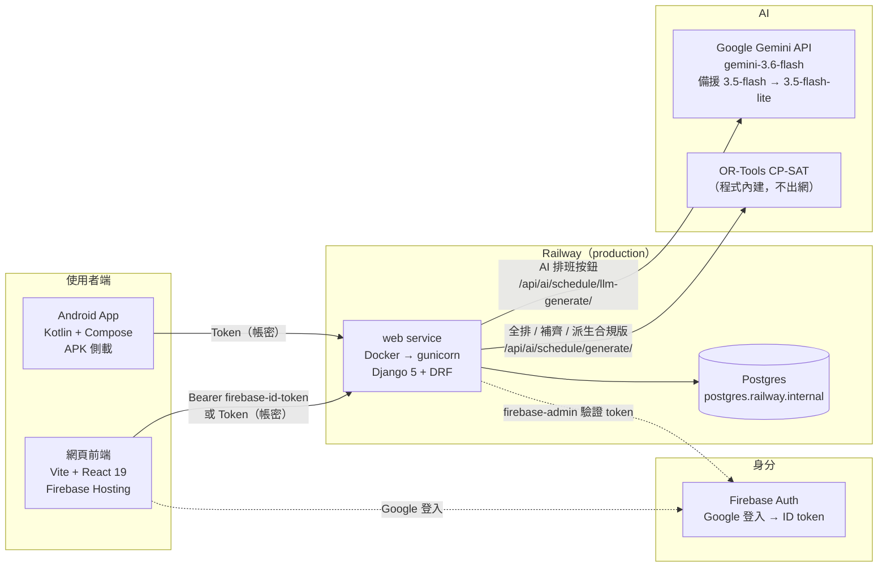
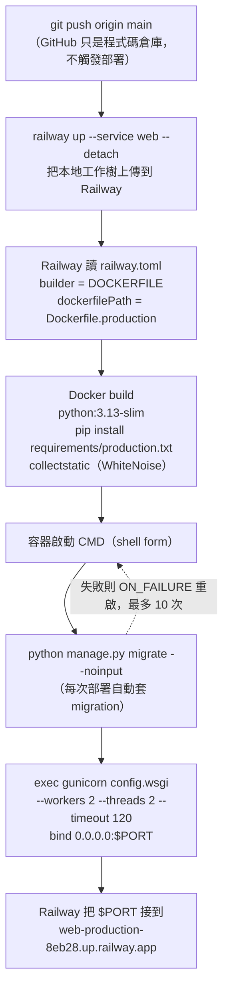
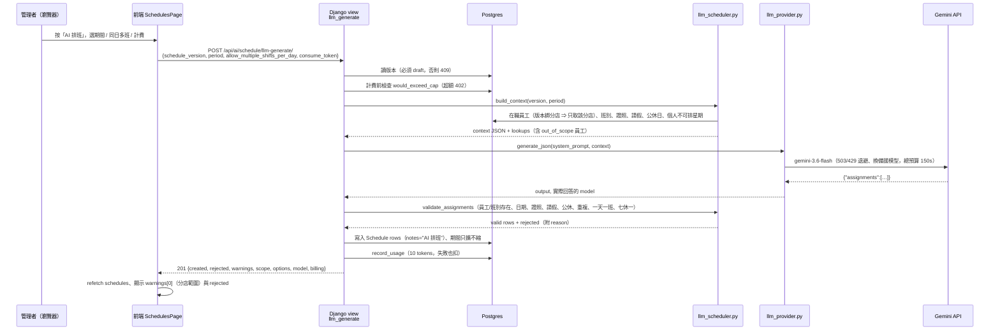
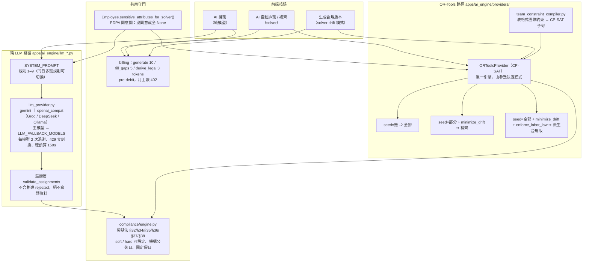
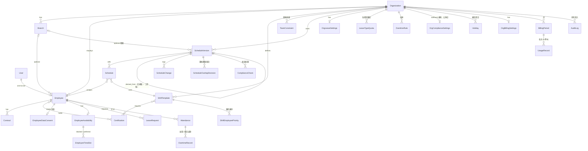
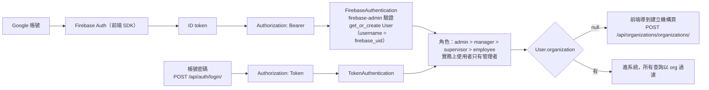
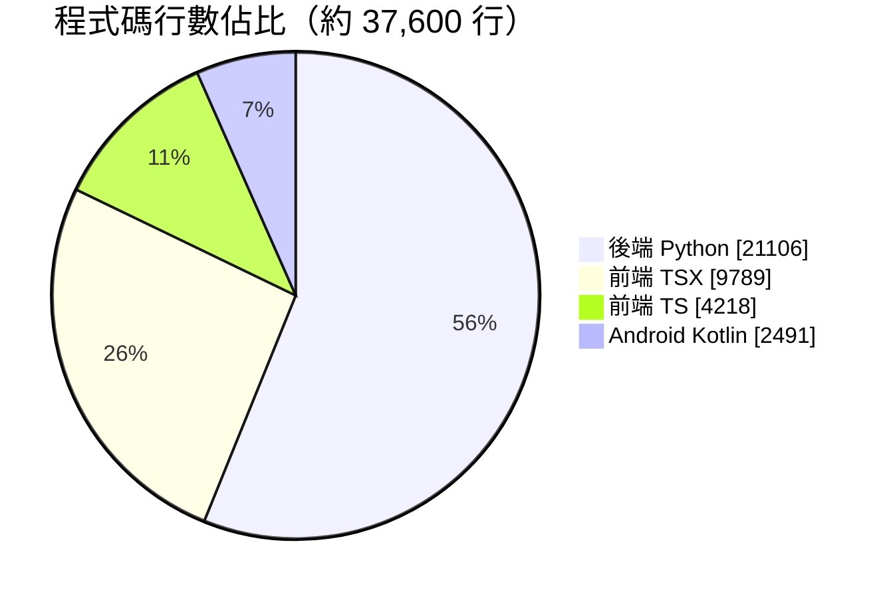

# 系統全圖 SYSTEM MAP（2026-10-13）

> 一頁看懂整個案子：前端、Android、後端、資料庫、AI、部署與技術棧。
> 圖用 Mermaid 畫，GitHub 網頁或手機 App 開這個檔就會直接渲染。
> 深入細節請看 [ARCHITECTURE.md](./ARCHITECTURE.md)（工程）、[BUSINESS_FLOWS.md](./BUSINESS_FLOWS.md)（業務）、[FRONTEND_API.md](./FRONTEND_API.md)（API）。

---

## 1. 三個 repo、一條後端

| Repo | 角色 | 技術 | 部署 | 負責人 |
|---|---|---|---|---|
| `sam9407287/scheduling-api` | 後端 API + AI 引擎 + 資料庫 | Django 5 / DRF / OR-Tools / Gemini | Railway（`web-production-8eb28.up.railway.app`） | Sam |
| `fnk59456/scheduling-frontend` | 網頁前端 | Vite 8 + React 19 + TypeScript + Tailwind 4 | Firebase Hosting（`intelligent-scheduling-system.web.app`） | Frank |
| `scheduling-android` | 原生 Android 客戶端（v0.1 demo） | Kotlin 2.0 + Jetpack Compose + Retrofit | 手動 APK | Sam |



**沒有在跑的東西**（刻意延後）：Celery worker 與 Redis 沒部署，所以 `run_async: true`
與每小時的計費門檻掃描（`scan_billing_thresholds`）在生產是停用狀態；Railway 變數裡沒有 `REDIS_URL`。

---

## 2. 後端怎麼被「啟動」的（launching）

從你按下部署到 API 可以接請求，中間發生的事：



| 項目 | 實際值 | 在哪裡定義 |
|---|---|---|
| 部署平台 | Railway，專案 `scheduling-api`，環境 `production`，服務 `web` | `railway status` |
| 建置方式 | Dockerfile（不是 Nixpacks） | `railway.toml` |
| 映像 | `python:3.13-slim` + `libpq-dev` + `postgresql-client` | `Dockerfile.production` |
| WSGI 伺服器 | gunicorn 26，2 workers × 2 threads，timeout 120s | `Dockerfile.production` CMD |
| 靜態檔 | WhiteNoise `CompressedManifestStaticFilesStorage` | `config/settings/production.py` |
| 設定模組 | `config.settings.production`（ENV 寫死在 Dockerfile） | `Dockerfile.production` |
| 資料庫 | Railway Postgres，`DATABASE_URL` 經 `dj-database-url`，`conn_max_age=600` | `config/settings/production.py` |
| 啟動時自動 migrate | 是 | CMD 第一段 |
| 重啟策略 | `ON_FAILURE`，最多 10 次 | `railway.toml` |
| 為什麼沒有 `startCommand` | Railway 的 startCommand 不展開 `${PORT:-8000}`，會把 gunicorn 綁錯；所以啟動鏈放在 Dockerfile 的 shell-form CMD | `railway.toml` 註解 |

**Railway 環境變數（只列名稱）**：`SECRET_KEY`、`DATABASE_URL`、`ALLOWED_HOSTS`、
`CORS_ALLOWED_ORIGINS`、`CSRF_TRUSTED_ORIGINS`、`FIREBASE_CREDENTIALS_JSON`、`GEMINI_API_KEY`、`PORT`
＋ Railway 自帶的 `RAILWAY_*`。

**本地開發的啟動**（和生產不同，不走 Docker）：

```bash
venv/bin/python manage.py runserver 8000      # SQLite + Token auth，settings = config.settings.development
cd ../scheduling-frontend && npm run dev       # Vite :3000，/api 代理到 :8000
pytest                                         # settings = config.settings.testing，SQLite in-memory
```

---

## 3. 一次「AI 排班」按鈕的完整路徑



---

## 4. AI 架構：兩條引擎、一個驗證層



| | 純 LLM（AI 排班按鈕） | OR-Tools solver |
|---|---|---|
| 產出 | 模型直接吐 assignments，驗證後**寫入**版本 | 解 CP-SAT，`/generate/` 目前**不落庫**（回傳建議） |
| 硬約束 | 靠 prompt + 驗證層（證照、請假、公休、重複、一天一班、七休一） | CP-SAT 硬約束（工時、休息、連續天數、min_staff、團隊約束、請假日） |
| 軟目標 | 無（prompt 要求平均分配、優先名單） | 公平 10 / 團隊約束 slack 15 / 加班 20 / 工時 5+2 / 偏好 5–0 / 時段 3 / drift / 班型 2 |
| 速度 | 30–60s，過載時最長 150s | 秒級 |
| 可換 | `LLM_PROVIDER` / `LLM_MODEL` / `LLM_BASE_URL` 環境變數 | `AI_SCHEDULE_PROVIDER` 設定 |

---

## 5. 資料模型（核心表）



11 個 Django app、37 個 model。每張表都掛在 `Organization` 底下，非超級使用者的查詢一律以 `request.user.organization` 過濾。
格子的身分是 `(employee_id, schedule_date, shift_template_id)` 三元組，不是 `Schedule.id`。

**關鍵欄位近期新增**：`Employee.pay_type`（月薪制 / 時薪制，10/13）、`ScheduleVersion.branch`（版本範圍）、
`OrgComplianceSettings.weekly_closed_days`（機構公休日）、`ScheduleVersion.derived_from`（合規版來源）。

---

## 6. 認證與權限



- 生產：Firebase（Google）與 Token（帳密）並存；Android 目前只用 Token。
- 本地 / 測試：只有 Token / Session，Firebase 整段跳過。
- Google 登入**不再自動開機構**（9/23 起），一個帳號一間機構。

---

## 7. 技術棧與佔比

### 7.1 後端（scheduling-api）

| 層 | 技術 | 版本（venv 實裝） |
|---|---|---|
| 語言 | Python | 3.13 |
| 框架 | Django / Django REST Framework | 5.0.14 / 3.15.2 |
| API 文件 | drf-spectacular（`/api/docs/` Swagger、`/api/redoc/`） | 0.27.2 |
| 資料庫 | PostgreSQL（生產）/ SQLite（本地與測試），psycopg2 | — |
| 認證 | firebase-admin、DRF TokenAuth | 6.9.0 |
| AI 求解 | Google OR-Tools CP-SAT | 9.15 |
| AI 生成 | Gemini API（REST，無 SDK）；可切 OpenAI 相容端點 | gemini-3.6-flash |
| 非同步 | Celery + Redis（**生產未啟用**） | 5.6.2 / 5.3.1 |
| 伺服器 | gunicorn + WhiteNoise | 26.0 / 6.12 |
| 驗證 | pydantic | 2.12 |
| 測試 | pytest + pytest-django，429 個測試 | — |
| 部署 | Railway + Docker | — |

### 7.2 網頁前端（scheduling-frontend）

| 層 | 技術 | 版本 |
|---|---|---|
| 建置 | Vite / TypeScript | 8.0 / 5.9 |
| UI | React 19、Tailwind CSS 4、lucide-react、next-themes（深色） | 19.2 / 4.2 |
| 路由 | react-router-dom | 7.13 |
| 資料 | @tanstack/react-query（伺服器狀態）、zustand（登入狀態）、axios | 5.94 / 5.0 / 1.13 |
| 認證 | firebase（Web SDK） | 12.15 |
| 匯出 | exceljs（班表 Excel） | 4.4 |
| 圖表 | recharts | 3.8 |
| i18n | i18next / react-i18next | 25 / 16 |
| 部署 | Firebase Hosting，`dist/` 全部 rewrite 到 `index.html` | — |

22 個頁面：儀表板、登入、建立機構、員工（列表 / 詳情）、排班、簽核總表、出勤、請假、加班、合規、AI 助理、操作日誌，以及系統設定 7 個分頁（班別模板、員工優先順序、排班規則、公休與假日、機構與分店、證照、請假）。

### 7.3 Android（scheduling-android）

| 層 | 技術 | 版本 |
|---|---|---|
| 語言 | Kotlin | 2.0.21 |
| UI | Jetpack Compose + Material 3、Navigation Compose | BOM 2024.12 |
| 狀態 | ViewModel + StateFlow | lifecycle 2.8.7 |
| 網路 | Retrofit + OkHttp + kotlinx.serialization | 2.11 / 4.12 / 1.7 |
| 儲存 | DataStore（token、伺服器位址） | 1.1.1 |
| DI | 手寫 AppContainer，無 Hilt | — |

### 7.4 程式碼佔比（不含 migrations、node_modules、venv）



| 部分 | 行數 | 佔比 |
|---|---|---|
| 後端 Python（含 429 個測試） | 21,106 | 56% |
| 前端 TypeScript + TSX | 14,007 | 37% |
| Android Kotlin | 2,491 | 7% |

---

## 8. 網址與入口速查

| 用途 | 位置 |
|---|---|
| 生產 API | `https://web-production-8eb28.up.railway.app/api/` |
| 生產 Swagger | `https://web-production-8eb28.up.railway.app/api/docs/` |
| 生產前端 | `https://intelligent-scheduling-system.web.app` |
| Railway 專案 | `railway open`（專案 `scheduling-api` / `production` / `web`） |
| 部署 | `railway up --service web --detach`（自動 migrate） |
| 看生產 log | `railway logs --service web` |
| 進生產容器 | `railway ssh --service web -- python manage.py shell` |
| 本地後端 | `http://localhost:8000`，帳號 `admin` / `admin123` |
| 本地前端 | `http://localhost:3000` |
| 前端交辦 | [FRONTEND_TODO_2026-10-13_AI_SCOPE.md](./FRONTEND_TODO_2026-10-13_AI_SCOPE.md) |
| PM 回饋 | [PM_FEEDBACK_BACKLOG.md](./PM_FEEDBACK_BACKLOG.md) |
| 功能成熟度 | [FEATURE_STATUS.md](./FEATURE_STATUS.md) |

---

## 9. 目前刻意沒做的

| 項目 | 狀態 | 原因 |
|---|---|---|
| Celery / Redis | 未部署 | 同步呼叫已夠用；`run_async` 與每小時計費提醒停用 |
| Stripe 真實付款 | 只有 schema（PaymentMethod mock） | Phase 4 |
| 勞基法 RAG | 未做 | Phase 4 |
| 變形工時、§49 女性夜間 | 未做 | 客戶未要求 |
| 邀請制登入 | 未做 | 現在是 Google 自助 + 一帳號一機構 |
| Android Google 登入 | 未做 | 需 Firebase Android app + SHA-1 |
| CI（GitHub Actions） | 兩個 repo 都沒有 | 測試在本地跑，部署手動 `railway up` / `firebase deploy` |
